<h1 align="center">Hi, I'm Yusuf 👋</h1>

  

  
  
  
  

  <a href="https://linkedin.com/in/canndalcii"><b>LinkedIn</b></a> · <a href="https://medium.com/@dalciyusuf"><b>Medium</b></a>

## 🚩 CTF write-ups

| Event | Categories | Write-up |
| --- | --- | --- |
| Türkiye Siber Güvenlik Kümelenmesi 4th CTF (Jan 2026) | Cryptography · steganography · forensics · password cracking | [Medium (TR)](https://medium.com/@dalciyusuf/siber-g%C3%BCvenlik-k%C3%BCmelenmesi-4-ctf-yar%C4%B1%C5%9Fmas%C4%B1-ee98988c556f) · [files](https://github.com/dalciyusuf/2026_TSGK_4_CTF) |
| picoCTF: RED | Steganography (LSB, zsteg) | [Medium (TR)](https://medium.com/@dalciyusuf/red-picoctf-tr-1aa4e317420b) |
| picoCTF: CanYouSee | Forensics (exiftool metadata) | [Medium (TR)](https://medium.com/@dalciyusuf/canyousee-picoctf-dd3951eafc79) |

**CTF toolkit:** exiftool · steghide · zsteg · John the Ripper

## ✍️ Latest on Medium

Latest posts on [Medium](https://medium.com/@dalciyusuf) (in Turkish):

<!-- BLOG-POST-LIST:START -->
- [Post-Kuantum Kriptografi: Q-Day’e Kaç Gün Kaldı?](https://medium.com/@dalciyusuf/post-kuantum-kriptografi-q-daye-ka%C3%A7-g%C3%BCn-kald%C4%B1-af324d15b1e4)
- [Sıfır Tıklama &lpar;Zero-Click&rpar; Dehşeti: Pegasus](https://medium.com/@dalciyusuf/s%C4%B1f%C4%B1r-t%C4%B1klama-zero-click-deh%C5%9Feti-pegasus-a6c591188dc1)
- [Açık Kaynağın Kırılgan Temeli: xz-utils Arka Kapısı](https://medium.com/@dalciyusuf/a%C3%A7%C4%B1k-kayna%C4%9F%C4%B1n-k%C4%B1r%C4%B1lgan-temeli-xz-utils-arka-kap%C4%B1s%C4%B1-ce8f84e4e616)
- [Bilgisayarınızın Sesini Dinleyerek Şifrenizi Çalabilirler](https://medium.com/@dalciyusuf/bilgisayar%C4%B1n%C4%B1z%C4%B1n-sesini-dinleyerek-%C5%9Fifrenizi-%C3%A7alabilirler-41bffa781836)
- [Bir Casino, Balık Tankı Yüzünden Soyuldu](https://medium.com/@dalciyusuf/bir-casino-bal%C4%B1k-tank%C4%B1-y%C3%BCz%C3%BCnden-soyuldu-86c5f046a5bf)
<!-- BLOG-POST-LIST:END -->

## 🔦 Projects

**[Driver assistant](https://github.com/dalciyusuf/Driver_Assistant_Project)** · Python · course project

A CNN traffic sign classifier (43 classes) combined with YOLOv8 pedestrian and vehicle detection, with driver warnings.

## 📜 Certificates

- Cisco: Introduction to Cybersecurity
- BTK Akademi: Kali Linux
- BTK Akademi: Introduction to Cybersecurity
